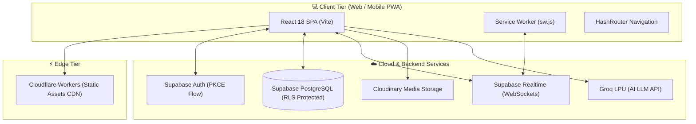
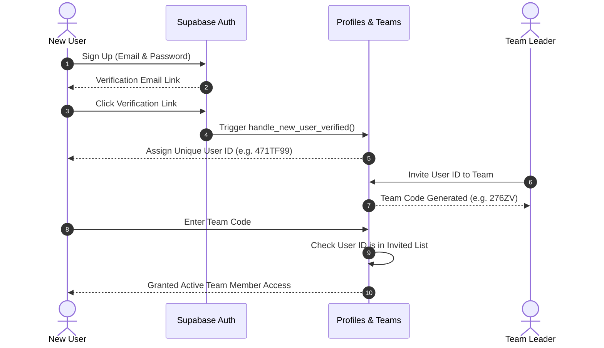
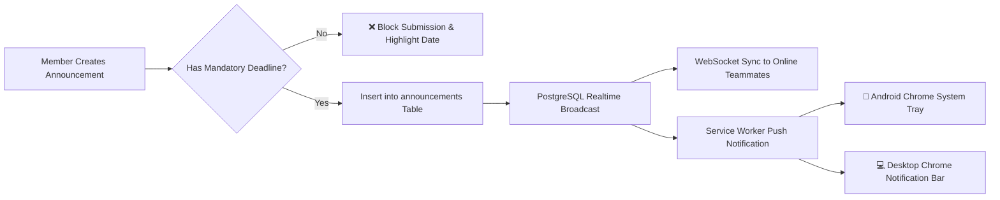
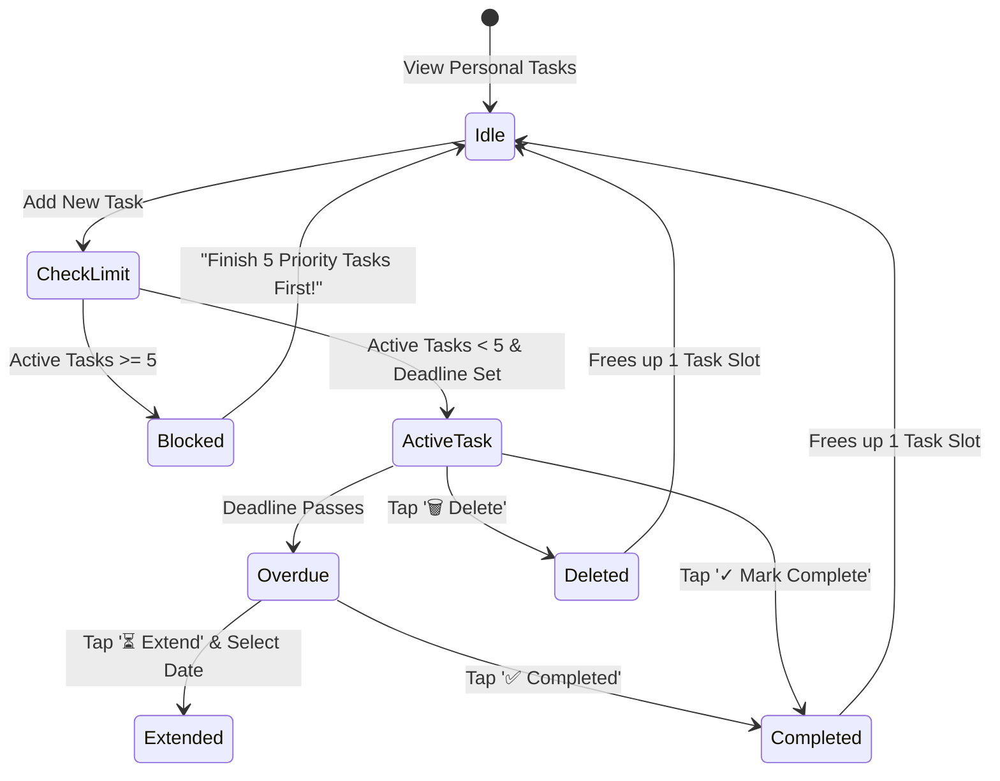

# 🚀 TeamSpace — All-in-One Team Workspace & Collaboration Suite

<div align="center">


### *Your Team's Modern Command Center*

[](https://react.dev/)
[](https://vitejs.dev/)
[](https://supabase.com/)
[](https://workers.cloudflare.com/)
[](https://cloudinary.com/)
[](https://groq.com/)
[](LICENSE)
[](#-security--protection)

**[🌐 Live Production Website](https://teamspace204.asutoshm359.workers.dev)** • **[Report Bug](https://github.com/AsutoshMishra-Engineer/Team-Space/issues)** • **[Request Feature](https://github.com/AsutoshMishra-Engineer/Team-Space/issues)**

</div>

---

## 📑 Table of Contents
- [🌟 Project Overview](#-project-overview)
- [✨ Key Features](#-key-features)
- [📐 System Architecture & Flowcharts](#-system-architecture--flowcharts)
  - [1. High-Level Architecture](#1-high-level-architecture)
  - [2. User Onboarding & Access Control Flow](#2-user-onboarding--access-control-flow)
  - [3. Real-Time Announcements & Push Alert Engine](#3-real-time-announcements--push-alert-engine)
  - [4. 5-Task Priority To-Do Workflow](#4-5-task-priority-to-do-workflow)
- [💻 Tech Stack](#-tech-stack)
- [📂 Project Directory Structure](#-project-directory-structure)
- [🛠️ Local Development & Setup](#️-local-development--setup)
- [🗄️ Database & Security Architecture](#️-database--security-architecture)
- [🌐 Cloudflare Deployment](#-cloudflare-deployment)
- [🛡️ Security & Protection](#-security--protection)
- [👨‍💻 Author & Credits](#-author--credits)

---

## 🌟 Project Overview

**TeamSpace** is a high-performance, real-time collaboration workspace designed for engineering teams, student cohorts, and agile developers. It unifies project management, team announcements, encrypted file sharing with inline previews, real-time chat, personal priority task queues, and an integrated AI assistant into a single intuitive interface.

Deployed globally on **Cloudflare Workers** with edge-distributed static assets and powered by **Supabase PostgreSQL** and **Groq LPU AI inference**, TeamSpace offers sub-second load times, mobile-first responsiveness, and zero cold starts.

---

## ✨ Key Features

### 👥 1. Role-Based Team Management
- **Automated Unique User IDs**: Unique `NNNLLNN` format (e.g. `471TF99`) generated upon email verification.
- **Team Creation & Secure Codes**: 5-character alphanumeric join codes (`NNNLL`).
- **Custom Member Roles**: Team leaders can assign and edit custom technical titles (`Frontend Lead`, `UI/UX Designer`, `ML Engineer`) displayed prominently on member badges.
- **Access Control Matrix**: Strict PostgreSQL Row Level Security (RLS) ensuring teams can only view their own workspace data.

### 📢 2. Compulsory-Deadline Team Announcements
- **Universal Announcement Board**: Any authorized team member can broadcast important team notices.
- **Compulsory Deadlines**: Forms enforce mandatory deadline selection with native calendar pickers (`showPicker()`) and 1-tap quick presets (`Today`, `Tomorrow`, `+2 Days`, `+1 Week`).
- **Deadline Extension Drawer**: Authors and team leaders can easily extend or update deadlines on the fly.

### 💬 3. WhatsApp-Style Real-Time Team Chat
- **Instant Synchronization**: Powered by Supabase Realtime WebSockets with optimistic UI updates.
- **Clean Message Bubbles**: Sender avatars, delivery double-ticks (`✓✓`), timestamps, and contextual single-message or full-chat clearing.

### 📁 4. High-Speed File Sharing & WhatsApp-Style In-Line Preview
- **Cloudinary Integration**: Direct-to-cloud upload with live progress tracking bar (supports files up to 25MB).
- **In-Line Media Previews**: View images, stream videos (`<video controls>`), playback audio notes (`<audio controls>`), scroll source code with syntax copy, and render PDFs/docs via Google Docs Viewer.
- **Direct Downloads**: Native Blob-stream downloads directly into your local device Downloads folder without popup blockers.

### 📝 5. 5-Task Priority To-Do Tracker
- **Focus-Driven Task Queue**: Enforces a strict **5 active priority tasks limit** per user.
- **Productivity Gate**: Adding a 6th task triggers an intelligent focus barrier:  
  *“Firstly finish these 5 priority tasks, after that do other or set other!”*
- **Overdue Alerts & Time Extension**: Tasks whose deadlines have passed surface instant completion checkoffs or inline date-extension pickers.

### 🤖 6. Built-in Groq AI Copilot
- **Ultra-Fast LLM Inference**: Slide-out assistant tab powered by Groq (`openai/gpt-oss-20b`, `qwen/qwen3.8-27b`, etc.).
- **Code & Problem Solving**: Formats syntax-highlighted code with 1-click clipboard copy, debugs stack traces, and assists in project documentation.

### 📱 7. Progressive Web App (PWA) & Mobile Push Alerts
- **Android Chrome Push Notifications**: Custom Service Worker (`sw.js`) utilizing the Web Push API for background notifications like native messaging apps.
- **System Sound Chime**: AudioContext-synthesized chime alerts when new team broadcasts arrive.

---

## 📐 System Architecture & Flowcharts

### 1. High-Level Architecture



---

### 2. User Onboarding & Access Control Flow



---

### 3. Real-Time Announcements & Push Alert Engine



---

### 4. 5-Task Priority To-Do Workflow



---

## 💻 Tech Stack

| Domain | Technology | Purpose |
| :--- | :--- | :--- |
| **Frontend Core** | React 18, Vite 6 | Lightning-fast component rendering & zero-bundle lag |
| **Routing** | React Router 7 (`HashRouter`) | Flawless SPA navigation on static edge hosts |
| **Styling & UI** | Custom Responsive CSS | Glassmorphism, cyber theme, dark mode presets |
| **Database & Auth** | Supabase (PostgreSQL 15) | Relational tables, secure RPCs, and PKCE Auth |
| **Realtime Engine** | Supabase Realtime Channels | Instant WebSocket broadcast for chat & alerts |
| **Cloud Storage** | Cloudinary REST API | Scalable media assets & direct-to-cloud file uploads |
| **AI Assistant** | Groq API (`openai/gpt-oss-20b`) | Real-time code generation and assistant inference |
| **Notifications** | Web Push API & Service Worker | Native mobile push notifications on Android & Desktop |
| **Hosting & Edge** | Cloudflare Workers Static Assets | Global serverless edge distribution with 100% uptime |

---

## 📂 Project Directory Structure

```plaintext
Team-Space/
├── public/
│   ├── logo.png                # High-resolution brand logo & PWA icon
│   ├── manifest.json           # Web App Manifest for mobile installation
│   └── sw.js                   # Service Worker for push notifications & cache
├── src/
│   ├── components/
│   │   ├── Announcements.jsx   # Team announcements with compulsory deadlines
│   │   ├── DeepSeekChat.jsx    # Collapsible Groq AI Copilot sidebar
│   │   ├── GoogleSearchBar.jsx # Quick web search utility
│   │   ├── Layout.jsx          # App wrapper with navbar & F-204 security footer
│   │   ├── LeaveTeam.jsx       # Safe team departure and ownership transfer
│   │   ├── ManageMembers.jsx   # Leader member invite & custom role editor
│   │   ├── NetworkStatus.jsx   # Offline/online reconnection notification bar
│   │   ├── PersonalSettings.jsx# 7 background themes, accent colors & quote editor
│   │   ├── PersonalTodos.jsx   # 5-task priority queue with deadline enforcement
│   │   ├── ProtectedRoute.jsx  # Authentication gatekeeper for secure routes
│   │   ├── SharedFiles.jsx     # Cloudinary file upload, previews & downloads
│   │   ├── Spinner.jsx         # Custom brand loading indicators
│   │   ├── TeamChat.jsx        # Real-time WebSocket team chat room
│   │   └── TeamInfoBar.jsx     # Team identity, access code & member chips
│   ├── context/
│   │   └── AuthContext.jsx     # Session, profile & dynamic theme state
│   ├── lib/
│   │   └── supabase.js         # Supabase client initialization
│   ├── pages/
│   │   ├── AuthCallbackPage.jsx# Email confirmation redirect handler
│   │   ├── CreateTeamPage.jsx  # New team initialization wizard
│   │   ├── JoinTeamPage.jsx    # Team code validation screen
│   │   ├── LandingPage.jsx     # Product hero, feature showcase & demo badge
│   │   ├── LoginPage.jsx       # User ID & password authentication
│   │   ├── MyTeamsPage.jsx     # Main workspace dashboard & teams grid
│   │   ├── RegisterPage.jsx    # New account sign up with email check
│   │   └── TeamWorkspacePage.jsx# Centralized collaborative team workspace
│   ├── App.jsx                 # App routing & React ErrorBoundary
│   ├── index.css               # Design system, glassmorphism & responsive rules
│   └── main.jsx                # DOM mounting & Service Worker registration
├── supabase/                   # Production PostgreSQL schemas & SQL migrations
│   ├── add-features.sql
│   ├── add-member-roles.sql    # Custom member roles schema & RPCs
│   ├── add-profile-fields.sql  # User ID generation & avatar triggers
│   ├── allow-member-announcements.sql # Open announcements & extend policies
│   ├── enable-realtime-notifications.sql
│   ├── fix-chat-delete.sql
│   ├── fix-relationships.sql
│   ├── schema.sql              # Base database table definitions & RLS
│   └── setup-web-push.sql      # Web push subscription storage
├── .env.example                # Template for environment credentials
├── .gitignore                  # Prevents secret keys from leaking to Git
├── package.json                # Project dependencies and build scripts
├── vercel.json                 # Vercel deployment configuration
└── vite.config.js              # Vite build configuration
```

---

## 🛠️ Local Development & Setup

### 1. Prerequisites
- **Node.js** (v18.0.0 or higher)
- **npm** or **pnpm**
- A free **[Supabase](https://supabase.com)** account
- A free **[Cloudinary](https://cloudinary.com)** account
- A free **[Groq Cloud](https://console.groq.com)** API key

### 2. Clone Repository
```bash
git clone https://github.com/AsutoshMishra-Engineer/Team-Space.git
cd Team-Space
```

### 3. Install Dependencies
```bash
npm install
```

### 4. Configure Environment Variables
Create a `.env` file in the root directory (refer to `.env.example`):
```env
VITE_SUPABASE_URL=https://your-project.supabase.co
VITE_SUPABASE_ANON_KEY=your-supabase-anon-key
VITE_CLOUDINARY_CLOUD_NAME=your-cloudinary-cloud-name
VITE_CLOUDINARY_UPLOAD_PRESET=your-unsigned-upload-preset
VITE_GROQ_API_KEY=gsk_your-groq-api-key
VITE_VAPID_PUBLIC_KEY=your-web-push-vapid-public-key
```

### 5. Run Database Migrations
Open your Supabase project's **SQL Editor** and run the scripts in `supabase/` in the following sequence:
1. `supabase/schema.sql` (Creates base tables and security definer functions)
2. `supabase/add-profile-fields.sql` (Enables automated unique User ID generation)
3. `supabase/add-member-roles.sql` (Enables leader-assigned custom titles)
4. `supabase/allow-member-announcements.sql` (Enables member announcements & extend RPCs)
5. `supabase/enable-realtime-notifications.sql` (Activates Realtime publication)

### 6. Start Local Dev Server
```bash
npm run dev
```
Open [http://localhost:5173](http://localhost:5173) in your browser.

---

## 🗄️ Database & Security Architecture

### Core Relational Tables
- **`public.profiles`**: Stores email, unique User ID (`304TX58`), username, avatar, and personal theme preferences.
- **`public.teams`**: Stores team names, project ideas, team codes, and creator IDs.
- **`public.team_members`**: Bridges users to teams with status (`pending`/`active`), base roles (`leader`/`member`), and custom titles (`member_role`).
- **`public.announcements`**: Team notices with compulsory deadline timestamps.
- **`public.chat_messages`**: Real-time room messages.
- **`public.team_files`**: Upload metadata, Cloudinary URLs, and uploader IDs.
- **`public.personal_todos`**: Private user tasks with deadline tracking.

### Security Implementation
- **Row Level Security (RLS)**: Enforced across all tables. Users can only query teams they belong to.
- **Security Definer RPCs**: Sensitive operations (`get_team_data`, `set_member_role`, `post_announcement`) run through verified stored procedures to prevent privilege escalation.
- **Client Key Hygiene**: Only public `anon` credentials exist on the frontend; master `service_role` keys are strictly isolated.

---

## 🌐 Cloudflare Deployment

This project is optimized for deployment on **Cloudflare Workers with Static Assets**:

```bash
# 1. Compile production build
npm run build

# Output is generated in the `dist` directory:
# dist/
# ├── assets/ (minified CSS & JS chunks)
# ├── index.html
# ├── logo.png
# ├── manifest.json
# └── sw.js
```

### Drag-and-Drop Deploy:
1. Navigate to the **Cloudflare Dashboard** -> **Workers & Pages**.
2. Select your Worker service (`teamspace204`).
3. Click **Upload Static Assets**.
4. Drag and drop the `dist/` folder.
5. Click **Deploy**. Your site goes live instantly across 300+ edge locations!

---

## 🛡️ Security & Protection

```
================================================================================
                    [ F-204 IT CELL PROTECTED ]
           Enterprise Identity & Workspace Guard Protocol
================================================================================
```
This application incorporates automated defenses against common web threats:
- **XSS Immunity**: Native React DOM escaping prevents unauthorized script execution.
- **Protected Environment**: Secret configuration files (`.env`) are strictly excluded from version control via `.gitignore`.
- **Private Data Partitioning**: Personal to-do tasks and private thoughts are encrypted at rest and invisible to fellow team members or team leaders.

---

## 👨‍💻 Author & Credits

**Designed & Developed by:**  
### **Asutosh Mishra**  
- **GitHub**: [@AsutoshMishra-Engineer](https://github.com/AsutoshMishra-Engineer)  
- **Project Repository**: [Team-Space](https://github.com/AsutoshMishra-Engineer/Team-Space)  
- **Live Application**: [teamspace204.asutoshm359.workers.dev](https://teamspace204.asutoshm359.workers.dev)

---

<div align="center">
  <sub>Built with ❤️ for collaborative engineering teams everywhere. Released under the MIT License.</sub>
</div>
