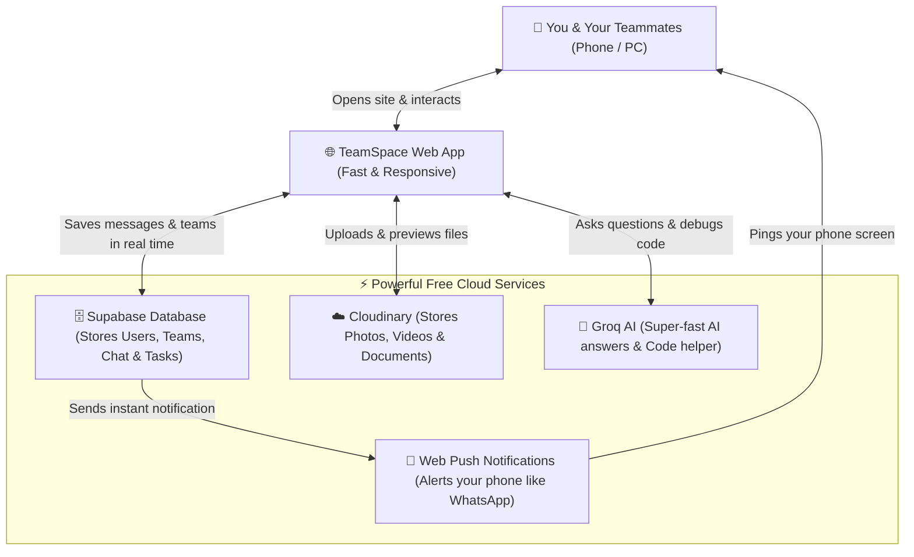
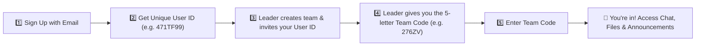
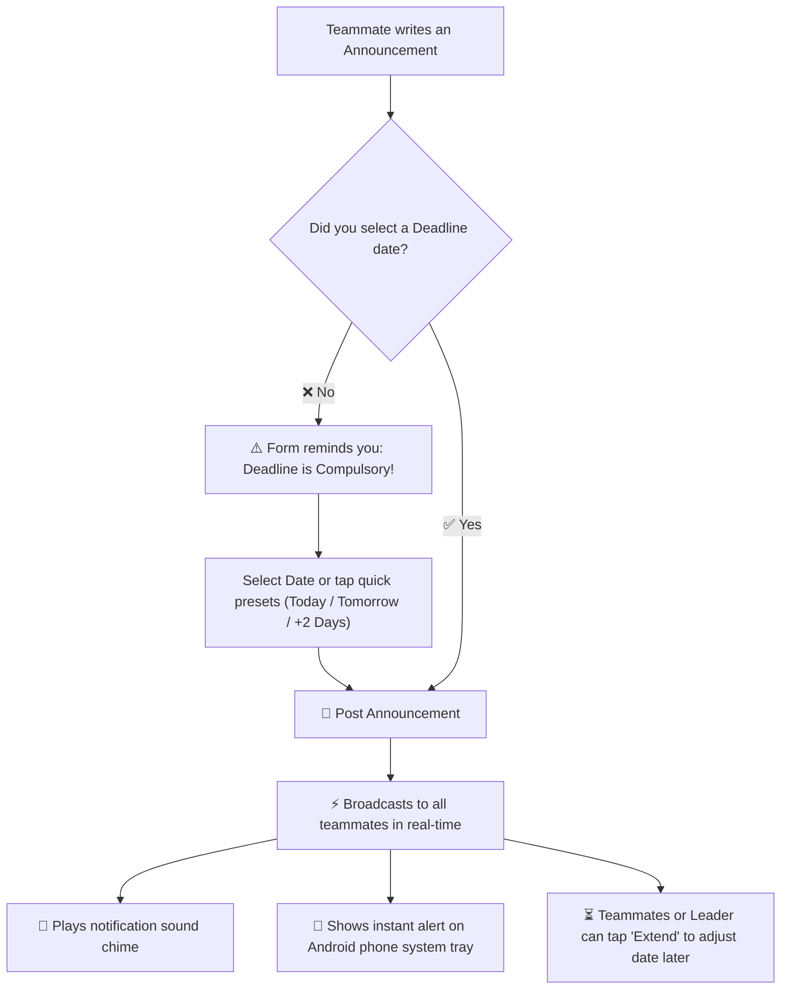
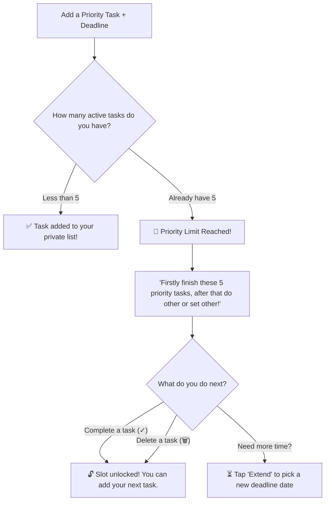

# 🚀 TeamSpace — Your Team's Modern Command Center

<div align="center">


### *Everything your team needs to work together — Chat, Files, Deadlines, Tasks & AI in one place.*

[](https://react.dev/)
[](https://vitejs.dev/)
[](https://supabase.com/)
[](https://workers.cloudflare.com/)
[](https://cloudinary.com/)
[](https://groq.com/)
[](LICENSE)
[](#-security--privacy)

**[🌐 Click Here to Open Live Website](https://teamspace204.asutoshm359.workers.dev)** • **[Report an Issue](https://github.com/AsutoshMishra-Engineer/Team-Space/issues)** • **[Suggest a Feature](https://github.com/AsutoshMishra-Engineer/Team-Space/issues)**

</div>

---

## 💡 What is TeamSpace in Simple Words?

Imagine you and your friends or colleagues are working on a project together. Normally, you have to juggle between four different apps:
- 📱 WhatsApp / Slack to chat
- 📁 Google Drive to share files and preview them
- 📝 Trello / Notes to track deadlines
- 🤖 ChatGPT to get help writing code or answering questions

**TeamSpace brings all of that into ONE fast, secure, and beautiful website.**

You can create private team rooms, invite your teammates with a short code, chat in real time, upload and preview any file directly, set priority deadlines, and get instant AI help whenever you're stuck.

---

## 🎯 Who is TeamSpace For?

- 🎓 **Students & College Groups**: For hackathons, semester projects, and group assignments.
- 💻 **Developers & Coding Teams**: Share code snippets, discuss bugs, and keep track of sprint tasks.
- 🚀 **Startups & Clubs**: Coordinate events, broadcast announcements with deadlines, and manage files without paying for expensive tools.

---

## 📑 Table of Contents
- [💡 What is TeamSpace?](#-what-is-teamspace-in-simple-words)
- [✨ Key Features (Explained Simply)](#-key-features-explained-simply)
- [📊 Visual Flowcharts (How It Works)](#-visual-flowcharts-how-it-works)
  - [1. The Big Picture: How TeamSpace Connects](#1-the-big-picture-how-teamspace-connects)
  - [2. How Users Join a Team](#2-how-users-join-a-team)
  - [3. How Team Announcements & Alerts Work](#3-how-team-announcements--alerts-work)
  - [4. The 5-Task Focus Rule (Anti-Procrastination)](#4-the-5-task-focus-rule-anti-procrastination)
- [📱 How to Use TeamSpace (Step-by-Step)](#-how-to-use-teamspace-step-by-step)
- [💻 Technology Behind TeamSpace](#-technology-behind-teamspace)
- [📂 Project Folder Structure](#-project-folder-structure)
- [🛠️ How to Run Locally on Your Computer](#️-how-to-run-locally-on-your-computer)
- [🌐 How to Deploy to Cloudflare](#-how-to-deploy-to-cloudflare)
- [🛡️ Security & Privacy](#️-security--privacy)
- [👨‍💻 Author & Project Info](#-author--project-info)

---

## ✨ Key Features (Explained Simply)

| Feature | What It Does | Why It's Useful |
| :--- | :--- | :--- |
| **👥 Private Teams & Custom Roles** | Every user gets a unique 7-character User ID (like `471TF99`). Leaders can invite members and assign roles (e.g., *Frontend Lead*, *UI Designer*). | No strangers can enter your team. Everyone knows who is doing what. |
| **📢 Announcements with Deadlines** | Anyone on the team can post an announcement, but picking a **deadline is compulsory**. Need more time? Just tap **⏳ Extend**. | Nobody forgets when a project milestone is due. |
| **💬 Real-Time Team Chat** | Instant messaging with delivery checks (`✓✓`), timestamps, sender avatars, and a 1-click chat clear option. | Talk with your team in real time without refreshing the page. |
| **📁 WhatsApp-Style File Previews** | Upload images, videos, audio clips, code, and PDFs. Preview them directly on the website or download straight to your phone/PC. | No need to download heavy files just to see what’s inside them. |
| **📝 5-Task Priority Tracker** | A private to-do list that lets you set up to **5 priority tasks**. If you try to add a 6th, it reminds you: *"Finish these 5 first!"* | Keeps you 100% focused on your top priorities instead of getting overwhelmed. |
| **🤖 Built-in AI Assistant** | A slide-out AI copilot powered by Groq. Ask it to write code, fix errors, or summarize project ideas with 1-click code copying. | Instant answers without leaving your project workspace. |
| **🔔 Mobile & Desktop Alerts** | Works as a Progressive Web App (PWA). Sends push alerts to Android phones and desktops when team announcements are made. | You never miss an urgent update, even if your phone screen is off. |
| **🎨 7 Custom Dark Themes** | Pick from Dark, Navy, Forest, Wine, Midnight, Charcoal, or Coffee, plus custom accent colors and a private motivational quote. | Personalize your workspace to match your style. |

---

## 📊 Visual Flowcharts (How It Works)

### 1. The Big Picture: How TeamSpace Connects

Here is how all the pieces of TeamSpace communicate smoothly together:



---

### 2. How Users Join a Team

Joining a team is safe, private, and invite-only:



---

### 3. How Team Announcements & Alerts Work

Deadlines are compulsory so that work actually gets finished on time:



---

### 4. The 5-Task Focus Rule (Anti-Procrastination)

To stop you from making giant, impossible to-do lists, TeamSpace limits your active priority tasks to **5**:



---

## 📱 How to Use TeamSpace (Step-by-Step)

### Step 1: Create Your Account
1. Open the [TeamSpace Website](https://teamspace204.asutoshm359.workers.dev).
2. Click **Get Started Free** and enter your email and password.
3. Check your email inbox and click the verification link.
4. You will receive your **unique User ID** (e.g. `471TF99`) in the top navigation bar.

### Step 2: Create or Join a Team
- **To Create a Team**: Click **+ Create a Team**, enter your team name and project idea. You'll receive a **Team Access Code** (e.g. `276ZV`) to share with your friends.
- **To Join a Team**: Ask your team leader to invite your User ID. Then click **Join a Team**, enter the Team Code, and click Enter!

### Step 3: Work Together
- **Chat**: Send real-time messages with your team in the chat room.
- **Announcements**: Post important notices and set a compulsory due date.
- **Files**: Drag and drop any image, document, video, or code file to preview and share it.
- **Priority Tasks**: Keep yourself accountable with your personal 5-task focus list.
- **AI Help**: Click the floating AI robot button on the side anytime you need code help or advice!

---

## 💻 Technology Behind TeamSpace

We chose simple, robust, and modern technologies so the app is fast, lightweight, and completely free to host:

- **Frontend Interface**: Built with **React 18** and **Vite** for instant page loads.
- **Styling**: Clean, custom CSS with glassmorphic cards and 7 dark-mode themes.
- **Database & Realtime**: **Supabase (PostgreSQL)** securely stores user accounts, teams, messages, and tasks.
- **File Storage**: **Cloudinary** handles fast uploads, photo/video hosting, and inline previews.
- **AI Copilot**: **Groq Cloud** powers the instant AI assistant with high-speed language models.
- **Push Notifications**: **Service Worker (`sw.js`)** runs in the background to show alerts on your phone screen.
- **Global Hosting**: **Cloudflare Workers** serves the site from over 300 cities worldwide with 100% uptime.

---

## 📂 Project Folder Structure

For developers looking at the code, here is where everything lives:

```plaintext
Team-Space/
├── public/                 # Static assets (Logo, PWA manifest, Service Worker)
│   ├── logo.png            # App logo & icon
│   ├── manifest.json       # PWA config (makes app installable on Android/iOS)
│   └── sw.js               # Background service worker for mobile notifications
├── src/
│   ├── components/         # Reusable building blocks of the website
│   │   ├── Announcements.jsx   # Team announcement board with compulsory deadlines
│   │   ├── DeepSeekChat.jsx    # Slide-out Groq AI assistant sidebar
│   │   ├── Layout.jsx          # Header navigation bar & F-204 security footer
│   │   ├── ManageMembers.jsx   # Leader member invite & custom role editor
│   │   ├── PersonalSettings.jsx# 7 background theme colors & quote customization
│   │   ├── PersonalTodos.jsx   # 5-task priority queue with deadline enforcement
│   │   ├── SharedFiles.jsx     # File upload, inline previews (video/audio/code) & download
│   │   ├── TeamChat.jsx        # WhatsApp-style real-time chat box
│   │   └── TeamInfoBar.jsx     # Team name, access code badge & member chips
│   ├── context/
│   │   └── AuthContext.jsx     # Manages login session and active theme colors
│   ├── lib/
│   │   └── supabase.js         # Connects the frontend to Supabase database
│   ├── pages/              # Main screens of the application
│   │   ├── LandingPage.jsx     # Welcome page with demo badge
│   │   ├── LoginPage.jsx       # User ID & password login
│   │   ├── RegisterPage.jsx    # New account signup
│   │   ├── MyTeamsPage.jsx     # Dashboard showing all your active teams
│   │   └── TeamWorkspacePage.jsx# The main team collaboration room
│   ├── App.jsx             # Main router & crash protection Error Boundary
│   ├── index.css           # Complete styling & responsive layout
│   └── main.jsx            # Entry point of the React app
├── supabase/               # SQL database tables, triggers & security scripts
├── .env.example            # Sample environment variables file
├── package.json            # Node.js project configuration
└── vite.config.js          # Vite build tool configuration
```

---

## 🛠️ How to Run Locally on Your Computer

If you want to run this website on your own machine:

### 1. Make sure you have Node.js installed
Download and install [Node.js](https://nodejs.org/) (version 18 or newer).

### 2. Download this project
```bash
git clone https://github.com/AsutoshMishra-Engineer/Team-Space.git
cd Team-Space
```

### 3. Install the packages
```bash
npm install
```

### 4. Set up your `.env` file
Copy `.env.example` to a new file named `.env` and fill in your free Supabase, Cloudinary, and Groq API keys:
```env
VITE_SUPABASE_URL=https://your-project.supabase.co
VITE_SUPABASE_ANON_KEY=your-supabase-anon-key
VITE_CLOUDINARY_CLOUD_NAME=your-cloudinary-name
VITE_CLOUDINARY_UPLOAD_PRESET=your-preset
VITE_GROQ_API_KEY=gsk_your-groq-key
```

### 5. Start the website
```bash
npm run dev
```
Open **`http://localhost:5173`** in your browser. You can now test and edit the site locally!

---

## 🌐 How to Deploy to Cloudflare

Deploying takes less than 60 seconds with **zero command line tools needed**:

1. Run the build command to generate the final website files:
   ```bash
   npm run build
   ```
2. This creates a clean **`dist/`** folder containing your compiled website.
3. Open your [Cloudflare Dashboard](https://dash.cloudflare.com/) -> **Workers & Pages**.
4. Click on your Worker -> **Upload Static Assets**.
5. Drag and drop the **`dist`** folder into Cloudflare.
6. Click **Deploy**. Your website is immediately updated and live across the world!

---

## 🛡️ Security & Privacy

```
================================================================================
                    [ F-204 IT CELL PROTECTED ]
           Enterprise Identity & Workspace Guard Protocol
================================================================================
```

We take your team's privacy very seriously:
- **Private Data Isolation**: Your personal to-do tasks and thoughts can **never** be seen by teammates or even the team leader.
- **Row Level Security (RLS)**: The database mathematically prevents anyone outside your team from viewing your messages or files.
- **Safe Keys**: Private database administrator keys are never included in the website code.
- **Protected Environment**: Your secret configuration files (`.env`) are strictly ignored by Git so passwords never leak.

---

## 👨‍💻 Author & Project Info

**Designed & Developed with ❤️ by:**  
### **Asutosh Mishra**  
- 🐙 **GitHub Profile**: [@AsutoshMishra-Engineer](https://github.com/AsutoshMishra-Engineer)  
- 📂 **Project Source Code**: [github.com/AsutoshMishra-Engineer/Team-Space](https://github.com/AsutoshMishra-Engineer/Team-Space)  
- 🌐 **Live Website**: [teamspace204.asutoshm359.workers.dev](https://teamspace204.asutoshm359.workers.dev)

---

<div align="center">
  <sub>Released under the <strong>MIT License</strong>. Free for students, developers, and teams everywhere.</sub>
</div>
