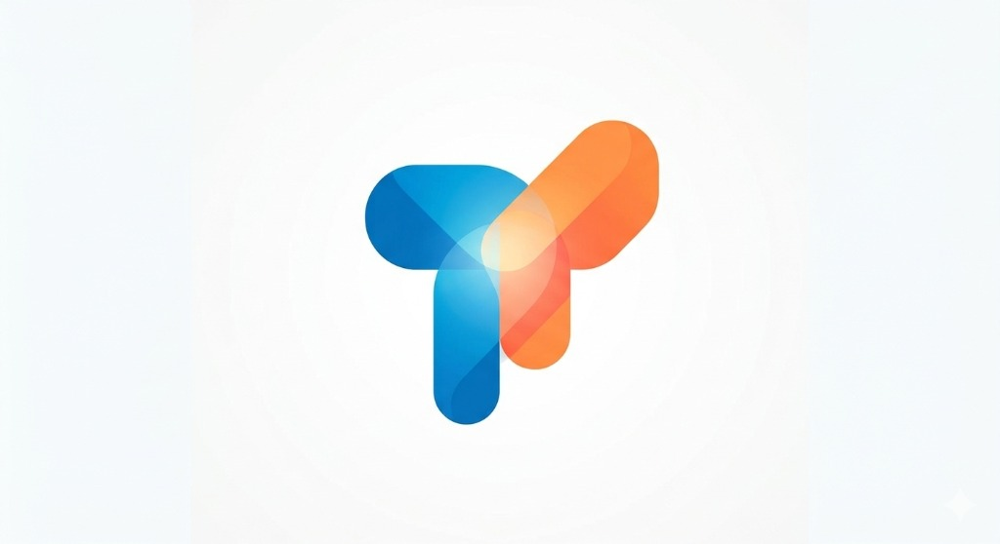
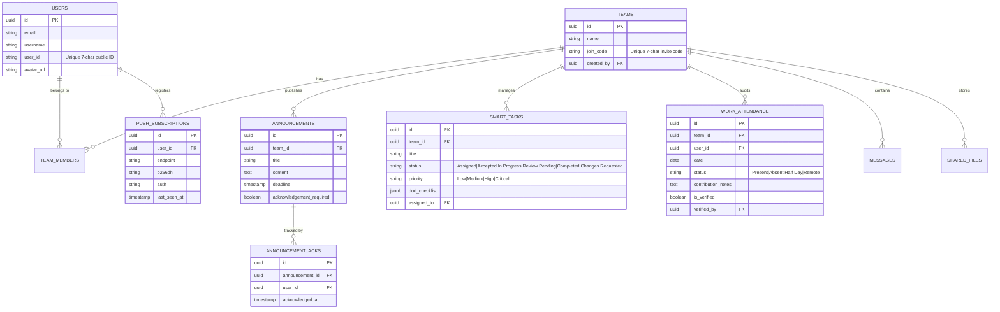

# 🚀 TeamSpace — Enterprise Team Workspace & Operations Hub

<div align="center">



### *Enterprise-Grade Command Center for Engineering Teams, Student Cohorts & Agile Workgroups*

[](https://teamspace204.asutoshm359.workers.dev)
[-3DDC84?style=for-the-badge&logo=android&logoColor=white)](https://github.com/AsutoshMishra-Engineer/Team-Space/releases/download/v1.0.0-android/app-debug.apk)
[](https://react.dev/)
[](https://vitejs.dev/)
[](https://supabase.com/)
[](https://workers.cloudflare.com/)
[](https://groq.com/)
[](https://firebase.google.com/)
[](#-security--privacy-architecture)

**[🌐 Live Production Website](https://teamspace204.asutoshm359.workers.dev)** • **[📲 Download Android App (.apk)](https://github.com/AsutoshMishra-Engineer/Team-Space/releases/download/v1.0.0-android/app-debug.apk)** • **[GitHub Repository](https://github.com/AsutoshMishra-Engineer/Team-Space)**

</div>

---

## 📖 Overview

**TeamSpace** is an all-in-one collaborative workspace engineered to streamline team execution. It consolidates team messaging, multi-format media repositories, compulsory-deadline announcements with mandatory sign-offs, a 6-state agile task management pipeline, leader-governed attendance and contribution auditing, and a dedicated Groq AI Work Studio into a single fast, responsive, and secure Progressive Web Application (PWA).

Deployed globally on **Cloudflare Workers Edge Network**, backed by **Supabase PostgreSQL with strict Row Level Security (RLS)**, and accelerated by **Groq LPU reasoning models**.

---

## ✨ Enterprise Feature Highlights

```
┌─────────────────────────────────────────────────────────────────────────────┐
│                             TEAMSPACE ECOSYSTEM                             │
├──────────────────────┬──────────────────────┬───────────────────────────────┤
│ 📢 Announcements     │ 📋 Smart Tasks       │ ⚡ Groq AI Work Studio         │
│ • Mandatory Sign-Off │ • 6-State Lifecycle  │ • Full-Screen Single Page     │
│ • Push Reminders     │ • DoD Checklists     │ • Zero-Token Work Guardrail   │
│ • Leader Audit Table │ • Leader Review/Req  │ • Code & Schema Synthesis     │
├──────────────────────┼──────────────────────┼───────────────────────────────┤
│ 👥 Attendance & Work │ 🔔 Android Web Push  │ 📁 Rich Media Vault           │
│ • Leader-Exclusive   │ • Multi-Device VAPID │ • In-Browser Media Previews   │
│ • Verified Notes     │ • Auto Token Sync    │ • Cloudinary Storage          │
│ • Monthly Analytics  │ • Heads-Up Vibration │ • Role-Based Access           │
└──────────────────────┴──────────────────────┴───────────────────────────────┘
```

### 1. 🔔 Reliable Android Push Notifications (Web Push API)
* **Standards-Based Web Push:** Built on the W3C Push API and Service Workers (`public/sw.js`), delivering notifications even when the browser or PWA is closed.
* **Auto-Subscription Background Sync:** User devices automatically register and synchronize ECDH P-256 VAPID subscriptions in the database upon authentication.
* **Edge Notification Dispatcher:** Cloudflare Worker backend API (`/api/send-push`) formats high-priority payloads with custom vibration sequences, badge icons, and announcement deep-linking.
* **Multi-Device Support:** Tracks multiple devices per user with automatic stale-token pruning.
* **Notification Preferences:** Fine-grained member toggles for Announcements, Tasks, Deadline Reminders, and Meeting Alerts.

### 2. 📢 Announcement Acknowledgement & Sign-Off System
* **Compulsory Deadlines & Priorities:** Every announcement requires an actionable deadline with options for *Normal*, *Important*, or *Mandatory Acknowledgement*.
* **Member Sign-Off Interface:** Clear, prominent acknowledgment button recording exact timestamps and member IDs to prevent dispute.
* **Leader Audit Dashboard:** Real-time sign-off progress bars, member-wise status tables (*Acknowledged* vs *Pending* with timestamps), and a 1-click **"Send Push Reminder to Pending Members"** action.

### 3. 📋 Smart Task Management System (6-State Agile Pipeline)
* **6-State Engineering Workflow:**
  $$\text{Assigned} \longrightarrow \text{Accepted} \longrightarrow \text{In Progress} \longrightarrow \text{Review Pending} \longrightarrow \begin{cases} \text{Completed} \\ \text{Changes Requested} \end{cases}$$
* **Definition of Done (DoD):** Interactive checklist items required before work can be submitted for review.
* **Submission & Review Cycle:** Members submit deliverable notes and repository/preview links; team leaders review, approve, or reject with actionable feedback.
* **Priority & Deadline Alerts:** Automated visual cues for Overdue, Critical, and Approaching milestones.

### 4. 👥 Leader-Exclusive Attendance & Contribution Tracking
* **Strict Role Enforcement:** Exclusively team leaders can log, verify, or modify daily attendance records.
* **Operational Statuses:** `Present`, `Absent`, `Half Day`, `Remote`.
* **Contribution & Task Notes:** Leaders log daily deliverables and tag records as `Verified`.
* **Audit Trail & Analytics:** Automatic logging of who marked and modified attendance, accompanied by monthly attendance percentage summaries and date filters.

### 5. ⚡ Dedicated Groq AI Work Studio (`/workspace/ai`)
* **Single-Page Viewport Layout:** Matches modern conversational AI tools (like ChatGPT and Gemini) with `100vh` zero outer-scroll design, smooth internal message stream scrolling, and a pinned bottom input console.
* **LPU Hardware Speed:** Powered by `openai/gpt-oss-120b` running on Groq LPU hardware with automatic fallback to `qwen/qwen3.8-27b` and `openai/gpt-oss-20b`.
* **Zero-Token Client Guardrail:** Intercepts casual, personal, or entertainment queries client-side before touching the network, preserving 100% of API tokens and returning an instant workplace refocus reminder.
* **Enterprise Work Culture:** Trained specifically for code refactoring, PostgreSQL RLS schema generation, 6-state task breakdowns, incident postmortems, and executive team communications.
* **Export & Tools:** 1-click Markdown (`.md`) export, session reset, and copyable syntax-highlighted code blocks.

### 6. 🌐 Dashboard Web Search
* Dedicated Google Search bar integrated directly into the Dashboard (`/workspace`) for external web research, technical documentation lookup, and public browsing.

---

## 🛠️ Technology Stack

| Layer | Technology | Purpose |
| :--- | :--- | :--- |
| **Frontend Framework** | React 18.3 + Vite 6.4 | Modern, fast component architecture and bundling |
| **Edge Compute & Host**| Cloudflare Workers + Static Assets | Global serverless edge routing, push dispatch & static hosting |
| **Database & Auth** | Supabase (PostgreSQL 15) | Relational database, Auth, RPC functions & Row Level Security |
| **Realtime Engine** | Supabase Realtime | WebSocket channels for live team chat and status broadcasts |
| **Media Cloud** | Cloudinary | Encrypted upload, storage, and in-browser preview of files |
| **AI Intelligence** | Groq API (LPU Inference Engine) | High-speed LLM reasoning for engineering and code workflows |
| **Push Protocol** | Web Push API + VAPID (RFC 8291/8292) | Background Android and desktop push notification delivery |
| **Security Architecture**| F-204 IT Cell Protocol + RLS | Least-privilege data isolation and strict input sanitization |

---

## 📂 Project Structure

```
Team-Space/
├── public/
│   ├── logo.png               # Official brand identity & app icon
│   ├── manifest.json          # PWA configuration manifest
│   └── sw.js                  # Service Worker (Web Push & notification click handler)
├── src/
│   ├── components/
│   │   ├── AnnouncementAcknowledgement.jsx # Leader audit table & member sign-off
│   │   ├── Announcements.jsx               # Announcements feed & deadline extenders
│   │   ├── GoogleSearchBar.jsx             # Clean Google search bar for dashboard
│   │   ├── Layout.jsx                      # App shell, navbar & auto-push token sync
│   │   ├── ManageMembers.jsx               # Leader member management & roles
│   │   ├── NetworkStatus.jsx               # Offline/online indicator banner
│   │   ├── NotificationPreferences.jsx     # Push category toggles
│   │   ├── PersonalSettings.jsx            # Dark themes & user profile settings
│   │   ├── PersonalTodos.jsx               # 5-task priority focus tracker
│   │   ├── ProtectedRoute.jsx              # Auth guard for workspace routes
│   │   ├── SharedFiles.jsx                 # Multi-format media vault with previews
│   │   ├── SmartTasks.jsx                  # 6-state agile task management pipeline
│   │   ├── TeamChat.jsx                    # Real-time WebSocket messaging
│   │   ├── TeamInfoBar.jsx                 # Team code, member counts & quick actions
│   │   └── WorkAttendance.jsx              # Leader-exclusive attendance tracking
│   ├── context/
│   │   └── AuthContext.jsx                 # Supabase session & user profile state
│   ├── lib/
│   │   ├── groqService.js                  # Groq API client, model fallback & work guardrail
│   │   ├── pushService.js                  # VAPID registration, token sync & permissions
│   │   └── supabase.js                     # Supabase client initialization
│   ├── pages/
│   │   ├── AIStudioPage.jsx                # Dedicated full-screen Groq AI workspace
│   │   ├── AuthCallbackPage.jsx            # OAuth and magic link callback handler
│   │   ├── CreateTeamPage.jsx              # Team generation flow
│   │   ├── JoinTeamPage.jsx                # 7-character invite code entry
│   │   ├── LandingPage.jsx                 # Product showcase & feature highlights
│   │   ├── LoginPage.jsx                   # User authentication & ID recovery
│   │   ├── MyTeamsPage.jsx                 # Main user dashboard with Google search
│   │   ├── RegisterPage.jsx                # Account creation
│   │   └── TeamWorkspacePage.jsx           # Main team collaboration command center
│   ├── worker-shim.js                      # Cloudflare Worker edge API router & push endpoint
│   ├── App.jsx                             # Router & global error boundary
│   ├── index.css                           # Unified CSS architecture (7 themes + responsive)
│   └── main.jsx                            # React entry point
├── supabase/                               # Database migrations & RLS policies
│   ├── add-acknowledgements.sql            # Schema for announcement acknowledgements
│   ├── add-smart-tasks.sql                 # Schema for 6-state tasks & DoD
│   ├── add-work-attendance.sql             # Schema for leader-exclusive attendance
│   ├── update-push-subscriptions.sql       # Schema for Web Push tokens
│   └── production-upgrade-complete.sql     # Consolidated idempotent database migration
├── wrangler.jsonc                          # Cloudflare Workers deployment config
├── vite.config.js                          # Vite build pipeline
└── package.json                            # Dependencies & scripts
```

---

## 🗄️ Database Schema & Security (Supabase PostgreSQL)

TeamSpace enforces strict **Row Level Security (RLS)** across all tables. Unauthenticated access is blocked, and members can only access teams they belong to.



---

## 🚀 Local Development Setup

### Prerequisites
- Node.js 18+ installed
- Supabase project with database migrations applied
- Cloudinary account for file storage
- Groq Cloud API key for the AI engine

### 1. Clone & Install
```bash
git clone https://github.com/AsutoshMishra-Engineer/Team-Space.git
cd Team-Space
npm install
```

### 2. Configure Environment Variables
Create a `.env` file in the root directory:
```env
VITE_SUPABASE_URL=https://your-supabase-project.supabase.co
VITE_SUPABASE_ANON_KEY=your-supabase-anon-key
VITE_CLOUDINARY_CLOUD_NAME=your-cloudinary-name
VITE_CLOUDINARY_UPLOAD_PRESET=your-upload-preset
VITE_GROQ_API_KEY=your-groq-api-key
VITE_VAPID_PUBLIC_KEY=your-vapid-public-key
VAPID_PRIVATE_KEY=your-vapid-private-key
VAPID_SUBJECT=mailto:admin@teamspace.com
```

### 3. Run Database Migrations
Execute [`supabase/production-upgrade-complete.sql`](supabase/production-upgrade-complete.sql) in your Supabase SQL Editor.

### 4. Start Development Server
```bash
npm run dev
```
Open `http://localhost:5173` in your browser.

---

## 🌐 Production Deployment (Cloudflare Workers)

TeamSpace builds as a static asset bundle paired with an edge Worker router for server-side push execution.

```bash
# 1. Build optimized production bundle
npm run build

# 2. Deploy directly to Cloudflare edge network
npx wrangler deploy
```

---

## 🛡️ Security & Privacy Architecture

* **F-204 IT Cell Protected:** Zero-trust architecture where all client actions are validated server-side.
* **Row Level Security (RLS):** Every query executed against Supabase verifies authenticated identity against `team_members`.
* **Zero Secret Leakage:** Privileged credentials (VAPID private keys, Supabase service roles) are strictly isolated from client-side bundles.
* **Zero-Token Guardrail:** Client-side regex protection rejects personal/casual queries before hitting external AI APIs, eliminating unnecessary token consumption.
* **DDoS & Bot Mitigation:** Fronted by Cloudflare's global edge network with automatic TLS encryption and bot protection.

---

## 👨‍💻 Author & Acknowledgements

* **Lead Architect & Developer:** Asutosh Mishra ([@AsutoshMishra-Engineer](https://github.com/AsutoshMishra-Engineer))
* **Platform:** TeamSpace Collaborative Systems
* **License:** [MIT License](LICENSE)

---

<div align="center">
  <sub>Protected under F-204 IT CELL Protocol • Built for Teams Who Build Things That Matter</sub>
</div>
